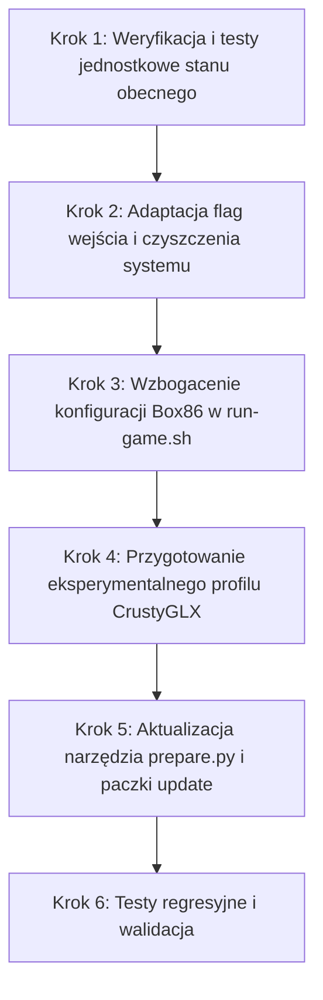

# Plan adaptacji wzorców PortMaster w Project Diablo 2 (R36S)

Dokument określa plan modernizacji i optymalizacji portu **Project Diablo 2** na konsolę **R36S** (Rockchip RK3326, ArkOS) w oparciu o rozwiązania z natywnych portów [PortMaster-New](file:///C:/src/PortMaster-New/ports).

---

## 1. Wnioski z analizy referencyjnych portów PortMaster

W repozytorium `PortMaster-New` przeanalizowano porty 32-bitowe i 64-bitowe działające na RK3326:
- [Steamworld Heist.sh](file:///C:/src/PortMaster-New/ports/steamworldheist/Steamworld%20Heist.sh) (Box86 + Westonwrap32 + CrustyGLX)
- [Steamworld Dig.sh](file:///C:/src/PortMaster-New/ports/steamworlddig/Steamworld%20Dig.sh) (Box86 + Westonwrap32)
- [Braid.sh](file:///C:/src/PortMaster-New/ports/braid/Braid.sh) (Box86 + Westonwrap32 + pulseaudio/alsa fallback)
- [Shovel Knight.sh](file:///C:/src/PortMaster-New/ports/shovel.knight/Shovel%20Knight.sh) (Box86 + czyszczenie tty + oga_events + SDL2 JGUID)
- [Super Meat Boy.sh](file:///C:/src/PortMaster-New/ports/supermeatboy/Super%20Meat%20Boy.sh) (Box86 + dynamiczna detekcja RK3326)
- [Osmos.sh](file:///C:/src/PortMaster-New/ports/osmos/Osmos.sh) (Box86/Box64 + Westonwrap + CrustyGLX)
- [Iconoclasts.sh](file:///C:/src/PortMaster-New/ports/iconoclasts/Iconoclasts.sh) (Box86 + GL4ES flagi)

Główne braki/różnice w dotychczasowym porcie PD2:
1. **Konflikt obsługi gamepadów**: Weston może próbować przechwytywać węzły `evdev` gamepada równolegle z `gptokeyb`.
2. **Mapowanie GUID kontrolera w Box86**: Brak flagi zapobiegającej rozjeżdżaniu się GUID kontrolera w SDL2 pod emulacją Box86.
3. **Brak restartu usług systemowych po wyjściu**: Po zamknięciu gry w ArkOS przyciski funkcyjne (jasność/głośność/usypianie obsługiwane przez daemon `oga_events`) mogą pozostać zablokowane.
4. **Pozostałości w buforze ramki konsoli (`/dev/tty0`)**: Brak wymuszonego czyszczenia ekranu po zamknięciu sesji DRM/Wayland.
5. **Alternatywny tor OpenGL (CrustyGLX)**: Wcześniejsza próba OpenGL kończyła się czarnym ekranem przez `headless noop` bez biblioteki scanoutu. PortMaster rozwiązuje to za pomocą `crusty_glx_gl4es` (`libcrusty.so`).

---

## 2. Kluczowe obszary modernizacji

### Obszar A: Izolacja wejścia i obsługa gamepada (evdev / gptokeyb)
* **Zmienna `CRUSTY_BLOCK_INPUT=1`**:
  * Dodanie do środowiska kompozytora Weston w [weston-session.sh](file:///c:/src/r36s-port-projectdiablo2/sdcard/ports/projectdiablo2/scripts/weston-session.sh).
  * Blokuje przechwytywanie urządzeń wejściowych przez Weston, gwarantując 100% priorytetu dla warstwy `gptokeyb`.
* **Zmienna `BOX86_SDL2_JGUID=1`**:
  * Zapobiega generowaniu niestabilnych lub pustych identyfikatorów GUID dla kontrolera R36S w warstwie Box86 (rozwiązanie sprawdzone w [Shovel Knight.sh](file:///C:/src/PortMaster-New/ports/shovel.knight/Shovel%20Knight.sh)).

### Obszar B: Cykl życia procesu, sprzątanie i restart daemona `oga_events`
* **Restart daemona zdarzeń sprzętowych**:
  * Dodanie w procedurze `cleanup()` w [weston-session.sh](file:///c:/src/r36s-port-projectdiablo2/sdcard/ports/projectdiablo2/scripts/weston-session.sh) oraz launcherach `.sh`:
    ```bash
    systemctl restart oga_events 2>/dev/null &
    ```
  * Przywraca pełną funkcjonalność klawiszy funkcyjnych ArkOS natychmiast po zakończeniu gry.
* **Czyszczenie wirtualnych terminali**:
  * Po wyłączeniu Weston i zwolnieniu `/dev/dri/card0`:
    ```bash
    printf "\033c" > /dev/tty0 2>/dev/null || true
    printf "\033c" > /dev/tty1 2>/dev/null || true
    ```
  * Zapobiega powidokom i migotaniu artefaktów na ekranie powrotnym EmulationStation.

### Obszar C: Flagi Box86 i diagnostyka błędów
* **Dodanie flag do środowiska uruchomieniowego [run-game.sh](file:///c:/src/r36s-port-projectdiablo2/sdcard/ports/projectdiablo2/scripts/run-game.sh)**:
  * `export BOX86_ALLOWMISSINGLIBS=1` — ignoruje brakujące, opcjonalne biblioteki systemowe x86 (nieblokujące wykonania).
  * `export BOX86_DLSYM_ERROR=1` — precyzyjniejsze logowanie błędów translacji symboli dynamicznych w `log.txt`.
  * `export BOX86_SDL2_JGUID=1` — stabilność GUID.
* **Nienaruszalność reguł D2**:
  * `BOX86_DYNAREC_SAFEFLAGS=1` pozostaje **bezwzględnie włączone** (silnik D2 zawiera samomodyfikujący się kod; wyłączenie skutkuje natychmiastowym crashowaniem przy rzucaniu zaklęć).
  * `BOX86_DYNAREC_CALLRET=0` pozostaje bezwzględnie równe 0.

### Obszar D: Eksperymentalny profil graficzny CrustyGLX (`crusty_glx_gl4es`)
* PortMaster w grach 32-bitowych ([Steamworld Heist.sh](file:///C:/src/PortMaster-New/ports/steamworldheist/Steamworld%20Heist.sh), [Braid.sh](file:///C:/src/PortMaster-New/ports/braid/Braid.sh)) nie używa pełnego renderera DRM Westona dla OpenGL, lecz:
  1. `lib_armhf/graphics/crusty_glx/libcrusty.so` jako `LD_PRELOAD`.
  2. `lib_armhf/graphics/gl4es_glxpass/libGL.so.1` jako backend OpenGL.
  3. `wp_weston` uruchamiany jako `headless noop kiosk`.
* **Krok adaptacyjny**:
  * Utworzenie nowego launchera testowego: `sdcard/ports/Project Diablo 2 - PortMaster GLX.sh`.
  * Launcher ten przetestuje, czy `cnc-ddraw` w trybie `opengl` w połączeniu z `libcrusty.so` (z `weston_pkg_0.2`) i `gl4es` jest w stanie poprawnie wyświetlić obraz z akceleracją GPU bez czarnego ekranu.
  * Główny launcher produkcyjny [Project Diablo 2.sh](file:///c:/src/r36s-port-projectdiablo2/sdcard/ports/Project%20Diablo%202.sh) (GDI) pozostaje w 100% nienaruszony jako bezpieczna baza produkcyjna.

---

## 3. Plan wdrożenia krok po kroku



### Krok 1: Weryfikacja i testy jednostkowe stanu obecnego
* Uruchomienie istniejącej bazy testów:
  ```powershell
  python tests/test_layout.py
  python tests/test_opengl_entry_fix.py
  python tests/test_gpu_runtime.py
  ```
* Potwierdzenie czystego stanu wyjściowego repozytorium.

### Krok 2: Adaptacja flag wejścia i czyszczenia systemu
* **Plik docelowy**: [sdcard/ports/projectdiablo2/scripts/weston-session.sh](file:///c:/src/r36s-port-projectdiablo2/sdcard/ports/projectdiablo2/scripts/weston-session.sh)
* **Zmiany**:
  1. W sekcji eksportów przed uruchomieniem kompozytora dodać `export CRUSTY_BLOCK_INPUT=1`.
  2. W funkcji `cleanup()` dodać czyszczenie terminali konsoli `printf "\033c" > /dev/tty0` i restart `oga_events`.
* **Plik docelowy**: [sdcard/ports/Project Diablo 2.sh](file:///c:/src/r36s-port-projectdiablo2/sdcard/ports/Project%20Diablo%202.sh) i pozostałe launchery w `sdcard/ports/`:
  1. Zapewnienie wywołania `systemctl restart oga_events &` oraz czyszczenia tty w procedurze wyjściowej.

### Krok 3: Wzbogacenie konfiguracji Box86 w [run-game.sh](file:///c:/src/r36s-port-projectdiablo2/sdcard/ports/projectdiablo2/scripts/run-game.sh)
* **Plik docelowy**: [sdcard/ports/projectdiablo2/scripts/run-game.sh](file:///c:/src/r36s-port-projectdiablo2/sdcard/ports/projectdiablo2/scripts/run-game.sh)
* **Zmiany**:
  1. Dopisanie `export BOX86_SDL2_JGUID=1`.
  2. Dopisanie `export BOX86_ALLOWMISSINGLIBS=1`.
  3. Dopisanie `export BOX86_DLSYM_ERROR=1`.
  4. Weryfikacja, że `BOX86_DYNAREC_SAFEFLAGS=1` pozostaje nienaruszone.

### Krok 4: Przygotowanie eksperymentalnego profilu CrustyGLX
* Utworzenie launchera: `sdcard/ports/Project Diablo 2 - PortMaster GLX.sh`.
* Konfiguracja profilu w launcherze:
  - Przekazanie do adaptera trybu `crusty_glx_gl4es`.
  - Wskazanie `ddraw.ini` ze skonfigurowanym rendererem `opengl`.
  - Załadowanie `lib_armhf/graphics/crusty_glx/libcrusty.so` i `lib_armhf/graphics/gl4es_glxpass/libGL.so.1`.

### Krok 5: Aktualizacja narzędzi budowania paczki update
* Weryfikacja `tools/prepare.py` pod kątem uwzględnienia nowych plików launchera.
* Aktualizacja manifestów [release-files.json](file:///c:/src/r36s-port-projectdiablo2/release-files.json) oraz [runtime-manifest.json](file:///c:/src/r36s-port-projectdiablo2/runtime-manifest.json) jeśli dołączane są nowe biblioteki compat.

### Krok 6: Testy regresyjne i dokumentacja
* Uruchomienie pełnego zestawu testów jednostkowych w `tests/`.
* Aktualizacja [docs/PORT-README.md](file:///c:/src/r36s-port-projectdiablo2/docs/PORT-README.md) oraz [MEMORY.md](file:///c:/src/r36s-port-projectdiablo2/MEMORY.md).
* Wdrożenie bezpośrednio z `sdcard/ports/` zgodnie z `AGENTS.md`: **bez `dist/` i bez generowania ZIP**. Narzędzie `prepare.py` oraz manifest plików pozostają walidowane bez wywołania `build-update`.

---

## Status wdrożenia

- Wdrożono izolację Crusty input, flagi Box86 i wspólne sprzątanie dla launcherów delegujących do głównego wejścia.
- Restart `oga_events.service` wykonuje launcher w przestrzeni nazw hosta, nie adapter z prywatnym `/run`. Stan aktywności zapamiętywany przed hookami PortMaster; początkowo wyłączona usługa nie jest uruchamiana. Restart nie blokuje powrotu do menu, polecenia mają timeouty.
- Dodano osobny launcher **Project Diablo 2 - PortMaster GLX**, profil `crusty_glx_gl4es`, walidację ARMHF przed headless/noop, wpis manifestu i allowlistę `prepare.py`. Produkcyjny profil GDI pozostaje domyślny.
- Bez nowych bibliotek compat: istniejące Crusty GLX i GL4ES pochodzą z przypiętego Westonpack; manifesty runtime nie wymagają zmiany.
- Dodano testy regresyjne sprzątania hosta, profilu GLX, flag przekazywanych do Wine oraz logowania nowego profilu. Wyniki końcowe zapisano w [MEMORY.md](<../MEMORY.md>).
- Bez budowania ZIP i bez wdrażania na fizyczną kartę. Źródłem wdrożenia pozostaje `sdcard/ports/`. Faktyczny obraz, wydajność GPU i przyciski systemowe po wyjściu wymagają testu na R36S.

## 4. Zasady bezpieczeństwa i kryteria akceptacji

1. **Bezwzględna ochrona trybu GDI**: [Project Diablo 2.sh](file:///c:/src/r36s-port-projectdiablo2/sdcard/ports/Project%20Diablo%202.sh) musi pozostać w pełni stabilnym, oficjalnym trybem produkcyjnym.
2. **Zachowanie kompatybilności ArkOS**: Restart `oga_events` nie może zakłócać działania systemów powłoki przy normalnym wyjściu użytkownika.
3. **Brak luźnych plików w `sdcard/ports/`**: Żadne pliki dokumentacji `.md` nie mogą znaleźć się w folderze `sdcard/ports/`. Plan i cała dokumentacja pozostają w dedykowanych folderach projektu (`plan/`, `docs/`).
4. **Testy jednostkowe zielone**: Wszystkie testy automatyczne w `tests/` muszą zakończyć się statusem powodzenia (`exit code 0`).
